# Vertical wind turbine

[](https://github.com/Franzelfx/vertical-wind-turbine/actions/workflows/checks.yml)


A small 3D-printed vertical-axis turbine on a timber post, charging a 3S Li-ion pack (the usual "12 V")
through its own electronics in a weatherproof box. Every part is generated by scripts from one file of
numbers.

> [!NOTE]
> **Digital design only.** The enclosure and drive train are modelled and pass collision checks. The
> schematic passes ERC, and the board is placed but not routed. There is no firmware. Nothing is built, and
> every power figure is an estimate. Next steps are in [plans/](plans/README.md).

<p align="center">
  <a href="docs/images/render-site-labelled.png">
    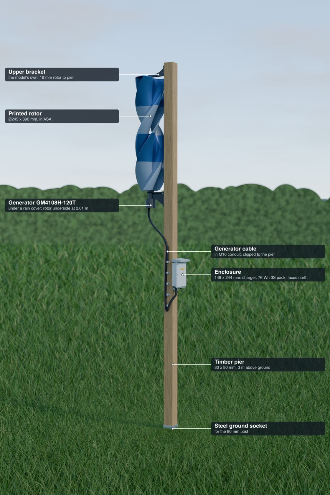
  </a>
</p>

## What to expect

This is a project to enjoy, not an energy source.

<!-- vawt:key-figures:start -->
| | |
| --- | --- |
| Rotor | 245 x 890 mm, printed in ASA |
| Post | 80 x 80 mm timber, 3 m tall |
| Battery | 3S2P Li-ion, 76 Wh, 9.0-12.6 V |
| Charges in winds of | 2.8 to 17.1 m/s |
| Best output | 19.1 W, at 17 m/s |
| Average output | 0.43 W at an assumed 3.5 m/s mean wind: 3.8 kWh a year |
| A 20 W solar panel, for scale | about 19 kWh a year |
| Requirements | 23 of 23 hold, on paper |
<!-- vawt:key-figures:end -->

Treat power figures as +-50 % until bench tests replace the assumptions: see
[sizing](docs/sizing.md), [assumptions](docs/assumptions.md) and [bench tests](plans/bench.md).

## How it works

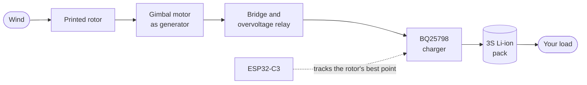

The relay needs no battery and no firmware: the overvoltage itself opens it
([ADR-006](docs/decisions/ADR-006-overvoltage-relay.md)).

## Pictures

All are computer renders, and the garden is set dressing. Select one for full size.

| On its post | From the side | The rotor from below |
| --- | --- | --- |
| [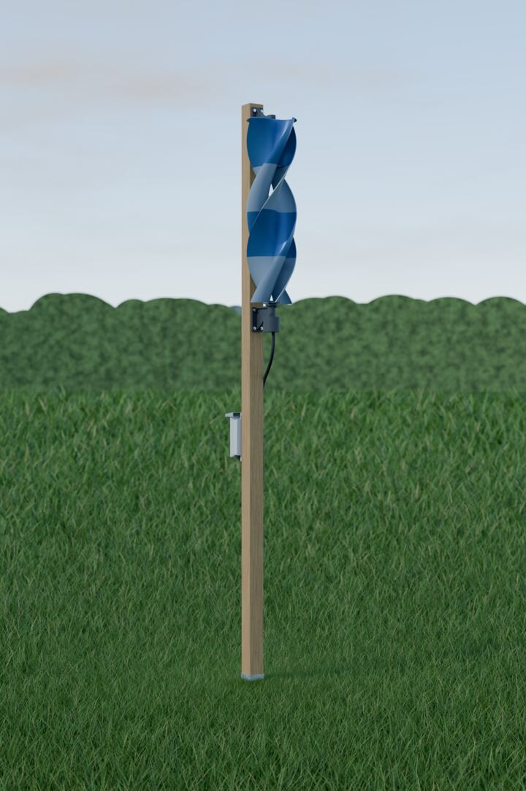](docs/images/render-site.png) | [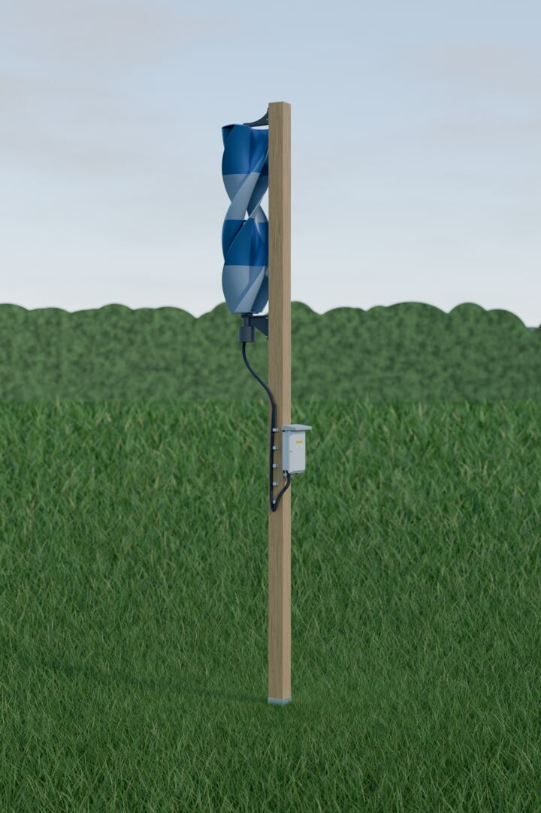](docs/images/render-site-rear.png) | [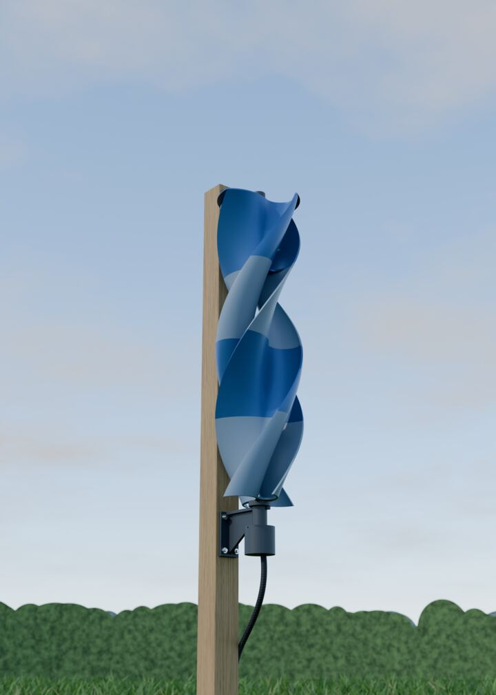](docs/images/render-turbine.png) |

| Upper bracket | Drive train | Cover off |
| --- | --- | --- |
| [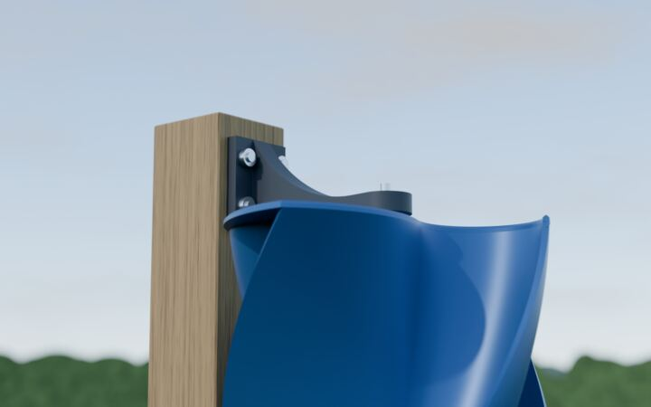](docs/images/render-turbine-top.png) | [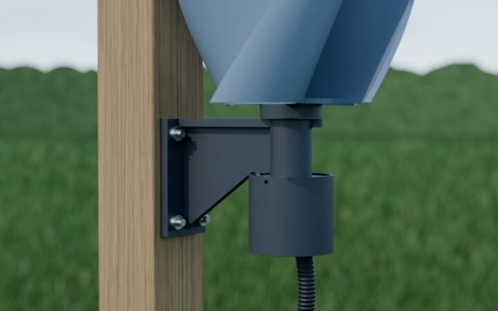](docs/images/render-drive.png) | [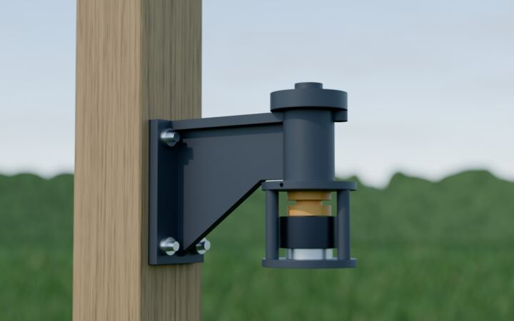](docs/images/render-drive-open.png) |

| Enclosure | Inside | Exploded |
| --- | --- | --- |
| [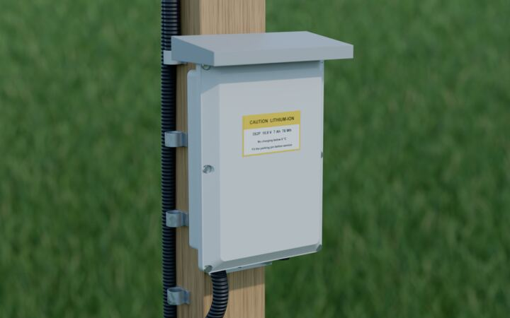](docs/images/render-enclosure.png) | [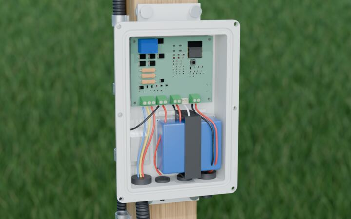](docs/images/render-enclosure-open.png) | [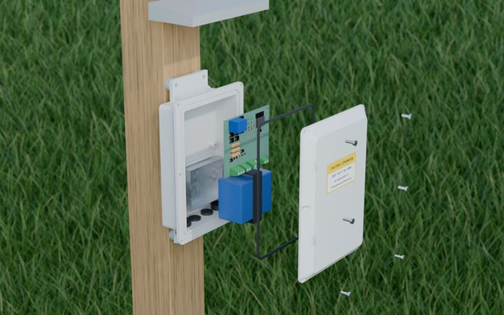](docs/images/render-enclosure-exploded.png) |

## Documentation

| Page | What it holds |
| --- | --- |
| [Requirements](plans/requirements.md) | Numbered limits and where each stands |
| [Sizing](docs/sizing.md) | Power, yield, overvoltage, stopping, structure, vibration |
| [Assumptions](docs/assumptions.md) | Every number nobody has measured |
| [Hardware](docs/hardware.md), [printing](docs/printing.md), [board parts](docs/bom.md) | What to buy and print |
| [Schematic](docs/images/charge-board-schematic.pdf) | The charge board, as a PDF |
| [Decisions](docs/README.md#decisions) | Why it is the way it is, including which choices were made by AI |
| [Plans](plans/README.md) | Mechanical, electronics and bench tests, with what is done |

## Layout

```text
src/vawt/          spec.py: every number. system/: sizing and requirements. io/: docs, booklet, mesh import
cad/freecad/       The parts and assembly, as FreeCAD Python
cad/vendor/        The licensed rotor, not in git
electronics/       KiCad: charge-board/ with its schematic as code, lib/ with project parts
firmware/          ESP32-C3, not started
tools/             run-checks, build-cad, build-electronics, render
report/            The booklet's text and layout, as Typst
tests/             Requirements, CAD report, ERC and DRC, doc integrity
plans/             Intent: requirements, mechanical, electronics, bench tests
docs/              State: generated pages, decisions, images
datasheets/        Parts' datasheets
bench/runs/        Raw logs from physical tests
build/             Generated: STEP, STL, FCStd, reports. Not committed
```

## Use

Needs [`uv`](https://docs.astral.sh/uv/), FreeCAD 1.1, KiCad 10 and Blender, each in its default place or
named by an environment variable ([CLAUDE.md](CLAUDE.md)). Git LFS holds the full-size renders and PDFs. For
the CAD build, put the rotor's 3MF in `cad/vendor/ugrinsky/` ([how](cad/vendor/ugrinsky/README.md)).

```sh
uv run vawt sizing          # the figures
tools/run-checks.sh         # everything, about 90 s
tools/render.sh             # the pictures, about 10 minutes (--samples 32 --width 800 for a draft)
uv run vawt pdf             # the booklet for friends: build/report/vertical-wind-turbine.pdf
```

Afterwards, `build/cad/wind-turbine.FCStd` opens in FreeCAD, `build/cad/` holds each part's STEP and STL, and
`electronics/charge-board/charge-board.kicad_pro` opens in KiCad. In FreeCAD, run
`cad/freecad/apply_colours.py` to colour the assembly. Change parts in the scripts, not in the generated
files ([ADR-001](docs/decisions/ADR-001-tools.md)).

## Safety

> [!WARNING]
> This has not been built, tested or certified.
>
> - **Not storm-proof unattended.** Fit the parking pin before forecast storms, and keep the fall zone clear
>   ([ADR-005](docs/decisions/ADR-005-storm-parking-pin.md)).
> - **A printed box does not contain a Li-ion fire** ([ADR-008](docs/decisions/ADR-008-enclosure.md)).
> - **The tips move fast.** Fit the pin before touching the rotor.

## Credits and licence

The rotor is GeoJolt's
["Ugrinsky Style wind Turbine"](https://makerworld.com/de/models/861294-ugrinsky-style-wind-turbine) from
MakerWorld, under its Standard Digital File License. GeoJolt holds the rights to that design, which appears in
the renders. Its files are not in this repository ([ADR-003](docs/decisions/ADR-003-rotor-licence.md)).

This project has no licence of its own yet, so its contents are not offered for reuse. The datasheets belong
to their makers.
